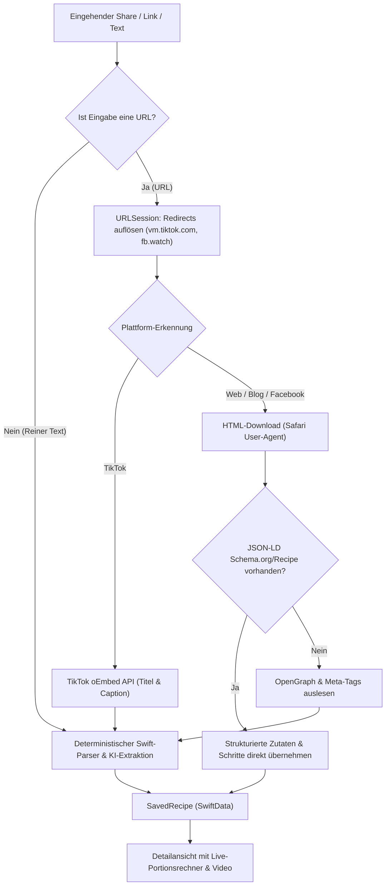

# Töpfle 🍲 – 100 % On-Device iOS Rezept-App

**Töpfle** ist eine native iOS-Rezept-App mit Share Extension und **vollständiger On-Device-Verarbeitung**. Die App läuft zu 100 % unabhängig auf dem iPhone – ohne eigene Server-Infrastruktur, ohne laufende Backend-Kosten und mit maximalem Datenschutz.

---

## 📱 Projekt-Highlights

- **100 % On-Device & Privat:** Alle Extraktionen, Webseiten-Abrufe, JSON-LD-Parsings und Textzerlegungen finden direkt auf dem iPhone statt.
- **Haupt-App:** Native SwiftUI App mit SwiftData (`de.toepfle.app`).
- **Share Extension:** Schnellspeichern von Links und markiertem Rezepttext aus TikTok, Facebook, Instagram und Safari (`de.toepfle.app.share`).
- **App Group:** `group.de.toepfle.app` (Gemeinsame Warteschlange & App-Einstellungen).
- **Intelligente Rezept-Extraktion:**
  - Automatische Redirect-Auflösung von Kurzlinks (z. B. `vm.tiktok.com`, `fb.watch`).
  - TikTok oEmbed API-Anbindung für Creator-Metadaten und vollständige Video-Captions.
  - Automatisches Auslesen von `schema.org/Recipe` (JSON-LD) von Food-Blogs und Webseiten.
  - Robuster deterministischer Swift-Parser für Mengenangaben, Brüche (`½`, `¼`, `1,5`) und Einheiten zur sofortigen Nutzung im Live-Portionsrechner.
  - Bereit für Apple FoundationModels (iOS 26+ On-Device LLM).
- **Bearbeitungsmodus (`EditRecipeSheet`):** Zutaten, Portionen, Schritte und Notizen können jederzeit manuell angepasst werden, während das Video eingebettet mitläuft.
- **Backup & Export:** Vollständiger JSON-Export aller Rezepte direkt in der App.

---

## 🛠 Lokaler Build & Entwicklung (macOS & Xcode)

Das Projekt nutzt **XcodeGen**, um das `.xcodeproj` dynamisch und konfliktfrei zu generieren.

```bash
# 1. XcodeGen installieren
brew install xcodegen

# 2. In den iOS-Ordner wechseln und Xcode-Projekt generieren
cd ios
xcodegen generate

# 3. Projekt in Xcode öffnen
open Toepfle.xcodeproj
```

---

## 🔐 GitHub Secrets für TestFlight CI/CD (Schlanker 4-Secrets-Workflow)

Für den automatischen TestFlight-Build und -Upload über `.github/workflows/ios-testflight.yml` werden **nur 4 Secrets** benötigt:

| Secret Name | Beschreibung |
| :--- | :--- |
| `APPLE_TEAM_ID` | Deine 10-stellige Apple Developer Team-ID (z. B. `A1B2C3D4E5`) |
| `APP_STORE_CONNECT_API_KEY_ID` | Key ID des App Store Connect API-Keys (z. B. `2X9R4HX4P3`) |
| `APP_STORE_CONNECT_ISSUER_ID` | Issuer ID von App Store Connect (UUID) |
| `APP_STORE_CONNECT_API_KEY_BASE64` | Base64-kodierter (oder Klartext-) Inhalt des privaten Schlüssels (`AuthKey_XXXXX.p8`) |

---

## 🏗 Architektur der On-Device Extraktion


